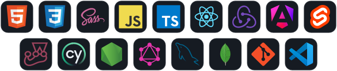

 

---

### 👋 About me

- 🌱 I'm currently working with **React, Angular, Svelte, Jest and Cypress**.
- 🎮 Lately I spend my free time in the **PS5 homebrew scene**: cheats, payload tooling and app features.
- 🥅 Goal: contribute more to open source.
- ⚡ Fun fact: I love books, games and tech.

### 🎮 PS5 homebrew

I like giving back to the scene. What I've worked on so far:

- 🕹️ **Cheat Runner**: a Diablo II: Resurrected cheat.
- 📦 **Payload Manager**: quality-of-life improvements.
- 📺 **Stremio Plus**: playback shortcuts.

Want a feature added to a payload? Open an issue on its repo and mention me. I help when I have time.

### 🛠️ Stack

  <picture>
    <source media="(prefers-color-scheme: light)" srcset="https://raw.githubusercontent.com/Dang3rZone/Dang3rZone/master/stack-light.svg" />
    
  </picture>

### 📈 Activity

  <picture>
    <source media="(prefers-color-scheme: dark)" srcset="https://raw.githubusercontent.com/Dang3rZone/Dang3rZone/output/github-snake-dark.svg" />
    <source media="(prefers-color-scheme: light)" srcset="https://raw.githubusercontent.com/Dang3rZone/Dang3rZone/output/github-snake.svg" />
    
  </picture>

 

  
  

---

  Found a bug in one of my PRs or have an idea? Issues and pull requests are welcome.

